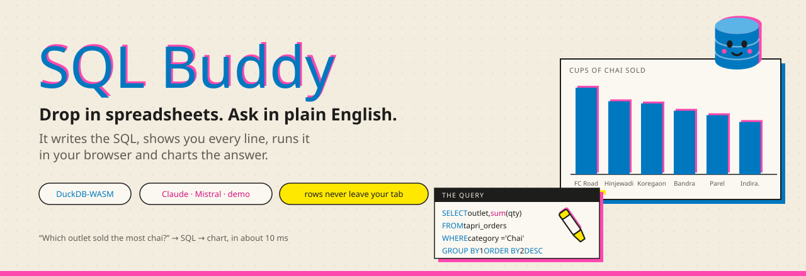
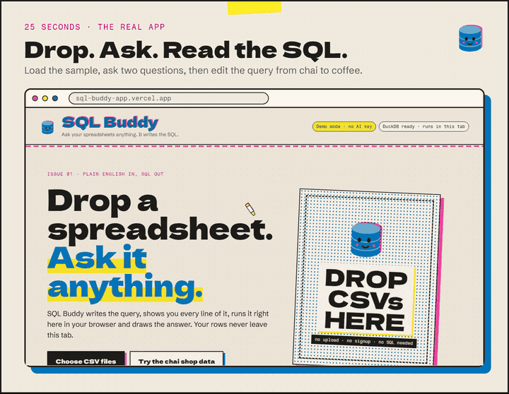
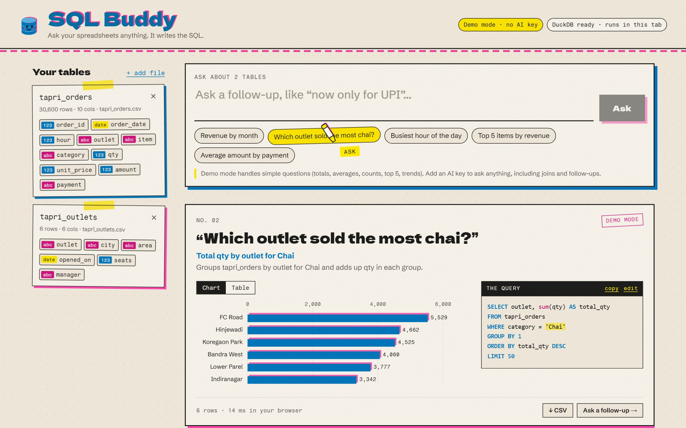
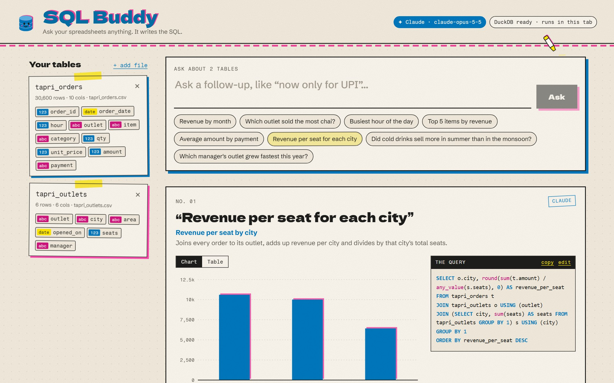
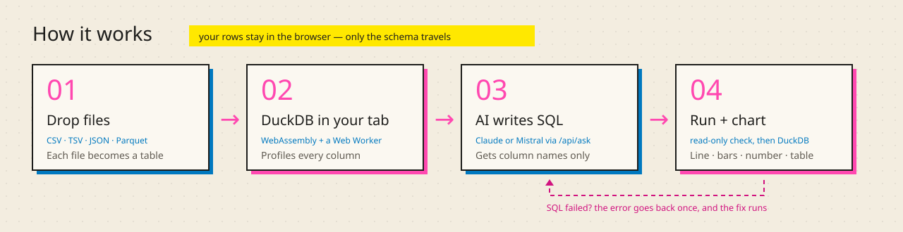
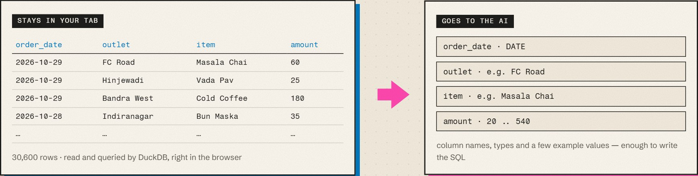
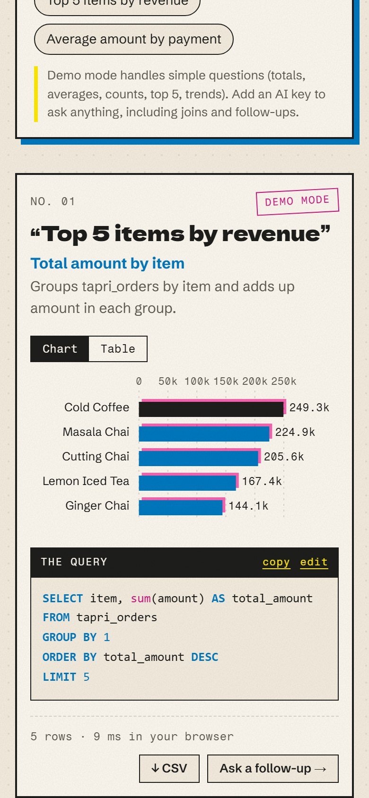

<div align="center">

<a href="https://sql-buddy-app.vercel.app">
  <picture>
    <source media="(prefers-color-scheme: dark)" srcset="docs/readme/banner-dark.svg" />
    
  </picture>
</a>

<p>
  <a href="https://sql-buddy-app.vercel.app"></a>
</p>


</div>

## See it work

<div align="center">
  <a href="docs/readme/demo.mp4">
    <picture>
      <source srcset="docs/readme/demo.webp" type="image/webp" />
      
    </picture>
  </a>
  <sub>25 seconds · <a href="docs/readme/demo.mp4">watch the MP4</a> · drop a CSV, ask, read the SQL, tweak it, get a chart</sub>
</div>

## What it does

| | |
|---|---|
| 📂 **Drop files** | CSV, TSV, JSON or Parquet. Each file becomes a table, and its columns show up as typed chips you can click into your question. |
| 💬 **Ask in English** | “Revenue by month”, “Which outlet sold the most chai?”, “Now only UPI”. Follow-ups build on earlier answers. |
| 🧾 **See the SQL** | Every answer prints its query on a receipt beside the chart. Click it, edit it, run it again. |
| 📊 **Get a chart** | A line for trends, bars for comparisons, a big number for single values, a scatter for two measures, or a table. Download any result as CSV. |
| 🔒 **Stays private** | DuckDB runs inside your browser tab. The AI sees column names, types and a few example values, never your rows. |
| 🔁 **Fixes itself** | If the AI’s SQL fails, the error goes back once and the corrected query runs. Only read-only queries on your tables are allowed. |

<table>
<tr>
<td width="50%"></td>
<td width="50%"></td>
</tr>
<tr>
<td><sub>Demo mode, no key needed: totals, averages, counts, top N, trends and filters.</sub></td>
<td><sub>With an AI key: joins, follow-ups and anything else. This one joins both sample tables.</sub></td>
</tr>
</table>

## How it works

<picture>
  <source media="(prefers-color-scheme: dark)" srcset="docs/readme/how-it-works-dark.svg" />
  
</picture>

1. A dropped file is registered with DuckDB-WASM in a Web Worker and loaded into a table. `SUMMARIZE` profiles each column.
2. The question and the column profiles go to `/api/ask`, a serverless function that asks the AI for one DuckDB query in a fixed JSON shape.
3. The browser checks the query only reads loaded tables (no writes, other files or URLs), runs it, and picks a chart from the result’s column types.

<table>
<tr>
<td width="62%"></td>
<td></td>
</tr>
<tr>
<td><sub>What stays in your tab, and what goes to the AI.</sub></td>
<td><sub>Works on phones too.</sub></td>
</tr>
</table>

## Run it

```bash
npm install
npm run dev
```

Open http://localhost:5200 and click **Try the chai shop data**. The samples are a fictional Pune chai chain, Tapri Co.: 30,600 orders across six outlets.

### AI keys

Without a key SQL Buddy runs in **demo mode**, with a small built-in translator for simple questions. For everything else, copy `.env.example` to `.env.local` (or add the variables in Vercel) and set one of these:

| Variable | What it does |
|---|---|
| `ANTHROPIC_API_KEY` | Uses Claude (`claude-opus-5-5` by default). Takes priority. |
| `CLAUDE_MODEL`, `CLAUDE_EFFORT` | Optional. Effort defaults to `low` for fast answers. |
| `LLM_API_KEY` | Any OpenAI-compatible API. Mistral by default. |
| `LLM_BASE_URL`, `LLM_MODEL` | Optional. Defaults: `https://api.mistral.ai/v1`, `mistral-small-latest`. |

Keys stay on the server. The header badge shows which provider is active, never the key.

<details>
<summary><b>Scripts</b></summary>

| Command | |
|---|---|
| `npm run dev` | Dev server on port 5200, with `/api/ask` built in |
| `npm test` | 40 unit tests: SQL guard, demo translator, chart picker, API route |
| `npm run build` | Typecheck and build to `dist/` |
| `npm run samples` | Regenerate the sample CSVs |
| `node docs/readme/make-svgs.mjs` | Rebuild the README banner and diagram |
| `node docs/readme/capture.mjs` | Re-capture README screenshots and the demo video (needs the dev server and ffmpeg) |

</details>

<details>
<summary><b>Project layout</b></summary>

```
api/ask.ts             Vercel function (GET: which AI is set up, POST: question to SQL)
server/ask.ts          Prompt, providers (Claude SDK / OpenAI-compatible), validation
src/lib/db.ts          DuckDB-WASM: load files, profile columns, run queries
src/lib/buddy.ts       Ask, run, retry once on error, demo fallback
src/lib/demo.ts        Rule-based translator for demo mode
src/lib/guard.ts       Read-only SQL check, shared by server and browser
src/lib/chart.ts       Picks a chart from the result's columns
src/components/        Landing page, charts (hand-drawn SVG), SQL receipt, cursor, mascot
scripts/make-samples.mjs   Builds the Tapri Co. sample data
docs/readme/           README banner, diagram, screenshots, demo video and their scripts
design/                Cursor options sheet
```
</details>

<details>
<summary><b>Design</b></summary>

A two-colour risograph zine: riso blue and fluoro pink on cream paper, with misregistered ink layers, halftone fills, tape strips and grain. Type is Dela Gothic One, Schibsted Grotesk and Fragment Mono. The mascot is a database cylinder whose eyes follow your pointer. The cursor is a highlighter pen that swipes a highlight under buttons; it was picked from [an options sheet](design/cursor-options.png) and turns off on touch screens and with reduced motion.
</details>

<details>
<summary><b>Deploying</b></summary>

The repo deploys to Vercel as is: Vite builds the static app and `api/ask.ts` becomes the function. Add an AI key under the project’s environment variables to leave demo mode.
</details>
